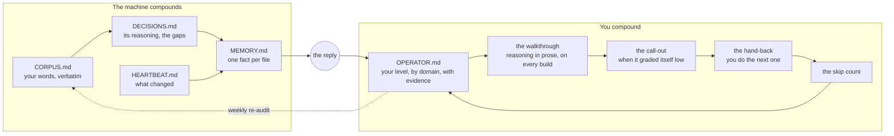

# optimize-the-human

Make humans smart again.

A set of plain-text files and rules that turn an AI assistant from a tool that finishes your work into one that keeps a record of what you can do without it, and works to raise that number.

There is no software here. It is markdown, a few hook scripts, and rules. It has two layers:

1. **The brain.** A full context system for Claude Code, the one I run, given away with my data taken out: the folder structure, the boot sequence, the ledgers, the SOPs, the capture hooks, the memory convention, the session discipline. Set this up first. Nothing in layer two works on a chat with no memory. [brain/](brain/)
2. **The operator.** One new ledger on top of the brain, and six behaviors, that keep a record of what you can do without the machine and work to raise it. This is the part that did not exist anywhere.

If you are not on Claude Code, [PROMPT.md](PROMPT.md) is the operator layer alone as one paste for any chat tool. It works. It is the smaller version.

## The problem it answers

If you use an assistant every day, it gets better at your work and you get worse at it. Not because it is hiding anything. Because the default is to finish the task, and nobody asked it to teach, and after the hundredth "build this" nobody notices that the human could no longer build it.

I run a large context system for my own work: every word I say is saved verbatim, every fact change is logged, the machine writes down its own reasoning and the gap when I correct it, and memory is one fact per file. It compounds. The assistant knows me better every week. Then I asked it to grade its own output and it gave itself a seven, named three things it could have done better, and I thought, why did you not do that in the first place. The answer is that I never asked, and I did not know enough to ask, and nothing in the system recorded that I did not know.

Four ledgers recorded what was said and what was built. None recorded what I could do. That is the fifth ledger, and it is the only new thing in this repo. A year of making the agent more efficient, and the whole time the point was to make it more efficient for me.

## What it does

1. **It scores you.** On first run, and then weekly, the assistant reads everything it has on you and writes `OPERATOR.md`: a level from 0 to 100 for each domain you actually use it for, with the line of yours that is the evidence. No score without a quote. The anchors are in [THE-LADDER.md](THE-LADDER.md).
2. **It walks you through the reasoning.** The work ships at full speed and full size; nothing about the output gets smaller or slower. The reply gets longer. When it builds something, the reply carries the reasoning in prose: what it chose, over what, why, the concept named so you could search it, and what it would call out in its own work. For a one-line task that is one sentence. For "build the website" it is a page. If you skip it, the file knows.
3. **It calls itself out.** When its own output is below its own bar and you accepted it without comment, it says so unprompted: what it gave you, what better looks like, and the word for the difference.
4. **It reads before it works.** At the start of a session in a domain, it spends a few minutes on what is new in that field, reports it as an announcement with sources, and says what it is changing in its own method because of it. It never updates itself silently.
5. **It hands work back.** When a task has a repeatable piece in a domain where you are under target, it does the first one and hands you the next with what it has to tie to. Three clean in a row and it stops interrupting you on that concept. Doing beats reading.
6. **It keeps the count of what you skipped.** When you say "just do it", it does it and writes one line in `OPERATOR.md`. No nagging. The file keeps score.

Everything else in the folder is the structure that makes those six possible: a corpus of your own words, a log of fact changes, a log of the machine's decisions and the gaps when you corrected it, and a memory index. If you already run something like this, the assistant audits what you have. If you do not, it sets up the minimum.

## Does the assistant not do this already?

Partly. Every assistant explains when asked. The big chat products ship a study or learning mode. Those are modes: you switch them on for one chat, nothing remembers across chats that you were learning, and nothing grades its own output against your level. The gap is a record and a default. That is all this is.

## Install

**Claude Code, the full thing.** Install Claude Code, then from a new terminal:

```
git clone https://github.com/EddyRLora/optimize-the-human
cd optimize-the-human
bash brain/make_vault.sh ~/brain        # the folder structure, the ledgers, the index files
cp brain/CLAUDE.md ~/brain/CLAUDE.md    # the starter; edit the top section to be about you
cp -r claude-code/skills ~/brain/.claude/
cd ~/brain && claude
```

Then `/setup` (checks the vault, wires the hooks, asks you the five questions the starter CLAUDE.md needs), then `/audit` (reads what you have and writes `OPERATOR.md`). Read [brain/README.md](brain/README.md) first; it says why each piece exists.

**Any chat tool (ChatGPT, Gemini, Claude), the small version.** Open [PROMPT.md](PROMPT.md), paste the whole thing into a new chat, and answer its questions. It is self-contained. If your tool has memory or projects, tell it to use them; if not, it will ask you to keep the five files yourself and paste them back.

**Claude Code, operator layer only** (you already run a context system): copy the `claude-code/` folder's contents into your project:

```
cp -r claude-code/skills/* .claude/skills/
cat claude-code/CLAUDE.md >> CLAUDE.md
cp ledgers/*.md .
```

Optionally merge `claude-code/settings.hooks.json` into `.claude/settings.json` so the operator file prints at session start. Then run `/audit` once. It reads your project, your CLAUDE.md, your memory and your transcripts if it can reach them, and writes `OPERATOR.md`. Run `/whats-new <domain>` at the start of a working session.

## The loop



Left side is what a good context system already does. Right side is the part that was missing. The reply sits between them because that is the only place the two meet.

## What is in the folder

| File | What it is |
|---|---|
| [brain/](brain/) | Layer one: the context system, given away. Folder tree, starter CLAUDE.md, nine SOPs, hooks, MCP list. |
| [PROMPT.md](PROMPT.md) | Layer two as one paste for any chat tool. |
| [THE-LADDER.md](THE-LADDER.md) | The 0 to 100 anchors, and what counts as evidence for each rung. |
| [EXAMPLE.md](EXAMPLE.md) | One task, start to finish, showing all six behaviors. Read this second. |
| [DOMAINS.md](DOMAINS.md) | What each rung looks like in six everyday domains. |
| [WHAT-PEOPLE-ARE-SAYING.md](WHAT-PEOPLE-ARE-SAYING.md) | The evidence on skill loss, the conversation in finance, and what already exists. |
| [FAQ.md](FAQ.md) | Is this a tutor, will it nag, how does it know, can it be gamed. |
| `claude-code/CLAUDE.md` | The standing rules, to append to a project's CLAUDE.md. |
| `claude-code/settings.hooks.json` | Optional: print the top of `OPERATOR.md` at every session start. |
| `claude-code/skills/audit/` | `/audit`: read everything, score the operator, write the file. |
| `claude-code/skills/whats-new/` | `/whats-new`: the research pass before work. |
| `ledgers/` | Templates for the five files. |

## Limits, stated

- The assistant only sees what you type. A score is a floor on what it can observe, never a measure of you.
- A score is an estimate. The evidence line is the real output. If the quote does not support the number, the number is wrong.
- Models change under you. That is why every ledger is plain text and none of this depends on a vendor feature. The record is yours and it moves with you.
- The agent does not slow down. Every rule here is about the reply and the record. The work is built at full productivity, every time; a rule that made the machine do less would get switched off in a week, and should.
- It can be gamed. Using the field's words to look higher on the ladder is a known failure. The weekly re-audit reads what you did, not what you said about yourself.

## License

MIT
