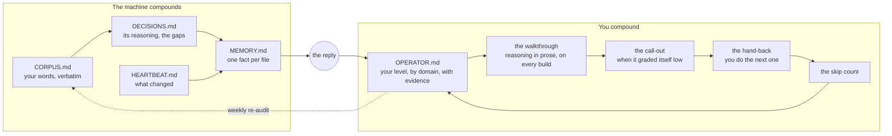

# optimize-the-human

Make humans smart again.

Your assistant keeps getting better at your work. This makes it keep a file on how good *you* are at it, with your own words as the evidence, and work to raise the number while it does the job at full speed.

Plain text and rules. No software. Paste one file into any chat tool, or set up the whole brain on Claude Code.

## What it does

1. **Scores you.** Reads everything it has on you and writes `OPERATOR.md`: a level from 0 to 100 for each thing you use it for, with a quoted line of yours under every number. No score without a quote. [The ladder](THE-LADDER.md).
2. **Walks you through the reasoning.** The work ships whole and at full speed. The reply gets longer: what it chose, over what, why, the concept you would have needed to ask for it yourself, named so you can search it.
3. **Calls itself out.** When its output is under its own bar and you accepted it, it says so without being asked, and gives the word for the difference.
4. **Reads before it works.** A few minutes on what is new in the field, reported as an announcement with sources. It never changes its method silently.
5. **Hands work back.** It does the first repeatable piece and hands you the second with what it has to tie to. Three clean in a row and it stops interrupting you on that concept.
6. **Counts what you skipped.** "Just do it" means it does it, and one line lands in the file. No nagging. The file keeps score, weekly.

[EXAMPLE.md](EXAMPLE.md) shows all six on one build, a landing page, start to finish.

## Install

**Any chat tool, 60 seconds.** Open [PROMPT.md](PROMPT.md), paste it into a new chat in ChatGPT, Gemini or Claude, and answer its questions. Self-contained. If your tool has memory or projects it keeps the files; if not, it asks you to keep five small files and paste them back.

**Claude Code, the whole brain.** This is the version I run, and the one I would push you toward, because a record of your level needs a record of you, and a chat with no memory has neither. [brain/](brain/) is my full context system given away with my data taken out: the folder structure, the boot sequence, the ledgers, nine SOPs, the capture hooks, the memory convention.

```
git clone https://github.com/EddyRLora/optimize-the-human
cd optimize-the-human
bash brain/make_vault.sh ~/brain
cp brain/CLAUDE.md ~/brain/CLAUDE.md
cp -r claude-code/skills ~/brain/.claude/
cd ~/brain && claude
```

Then `/setup`, then `/audit`. Read [brain/README.md](brain/README.md) once; it says why every piece exists.

**Already run a context system?** Copy `claude-code/` into your project and run `/audit`. It reads what you have and adds the one file that is missing.

## First run: on me

I ran the audit on myself before publishing. Three of the rows, with the evidence the machine quoted back at me:

| Domain | Level | Rung | Evidence |
|---|---|---|---|
| Working with the assistant (context, sessions, delegation) | 78 | Specify | "the point of starting the other sessions and bringing them to compact is so that it focuses, almost like ctrl+f the info specific for that session now" |
| Writing for a reader | 60 | Explain | "once you started saying 'I will be straight with you' that's AI brother, heck no" |
| Design (sites, notes, creative) | 44 | Explain, low | "the hero is three things, not one, and stops short of the fold" |

The first number is the one most people are highest in and least aware of, and it is the one that moves the others fastest, because a better brief is a better teacher. The rest of my file is private. Yours will be too.

## The loop



Left side is what a good context system already does. Right side is the part that was missing. The reply is the only place the two meet.

## Why I built it

I spent a year building the left side. Every word I say is saved verbatim, every fact change gets a line, the machine writes down its own reasoning and the gap when I correct it, memory is one fact per file. It compounds; the assistant knows me better every week.

Then I asked it to grade its own output. It gave itself a seven, named three things it could have done better, and all three were right. My first thought was, why did you not do that in the first place. The answer is that I never asked, and I did not know enough to ask, and nothing in a year of records had noticed that I did not know.

Four ledgers of what was said and what was built. None of what I could do. That is the fifth ledger, and it is the only new thing here. A year of making the agent more efficient, and the whole time the point was to make it more efficient for me.

## Does the assistant not already do this?

Partly. Every assistant explains when asked. Claude Code has an Explanatory style and a Learning style; ChatGPT and Gemini have study modes. Those are modes: on for one session, nothing persists about where you are, and nothing grades the machine's own output against your level. The gap is a record and a default. [What exists, and the evidence that the gap is real](WHAT-PEOPLE-ARE-SAYING.md).

## In the folder

| File | What it is |
|---|---|
| [PROMPT.md](PROMPT.md) | The operator layer as one paste for any chat tool. |
| [THE-LADDER.md](THE-LADDER.md) | The 0 to 100 anchors, the evidence per rung, how it knows without being told. |
| [EXAMPLE.md](EXAMPLE.md) | One build, all six behaviors. |
| [DOMAINS.md](DOMAINS.md) | What each rung looks like in six everyday domains. |
| [WHAT-PEOPLE-ARE-SAYING.md](WHAT-PEOPLE-ARE-SAYING.md) | The studies, the conversation in finance, what already exists. |
| [FAQ.md](FAQ.md) | Is this a tutor, will it slow the agent, how does it know, can it be gamed. |
| [brain/](brain/) | The context system: vault builder, starter CLAUDE.md, nine SOPs, hooks, MCP list. |
| `claude-code/` | The rules block, `/setup`, `/audit`, `/whats-new`, an optional session-start hook. |
| `ledgers/` | Templates for the five files. |

## Limits, stated

- The assistant only sees what you type. A score is a floor on what it can observe, never a measure of you.
- A score is an estimate. The quote is the real output. If the quote does not support the number, the number is wrong.
- The agent does not slow down. Every rule here is about the reply and the record. A rule that made the machine do less would get switched off in a week, and should.
- Models change under you. That is why everything is plain text and nothing depends on a vendor feature. The record is yours and it moves with you.
- It can be gamed. Using the field's words to look higher is the known failure; the weekly re-audit reads what you did, not what you said about yourself.

## License

MIT
